# Fandex

[](https://github.com/sbm2310/fandex/actions/workflows/ci.yml)

**Collect across formats — organized by universe and character.**

Fandex is a collection app for fans who collect comics, manga, fantasy books, premium figures and LEGO. Collector apps today are either single-category (LEGO-only, figures-only) or generic catalogers with blank fields. Fandex is built around how fans actually think about their shelves: _everything I own from Middle-earth, Batman or One Piece_, across every format.

<table>
  <tr>
    <td>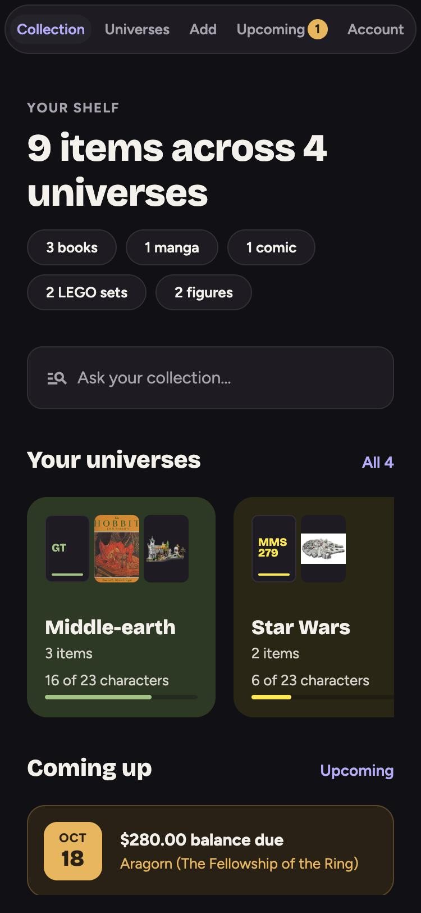</td>
    <td>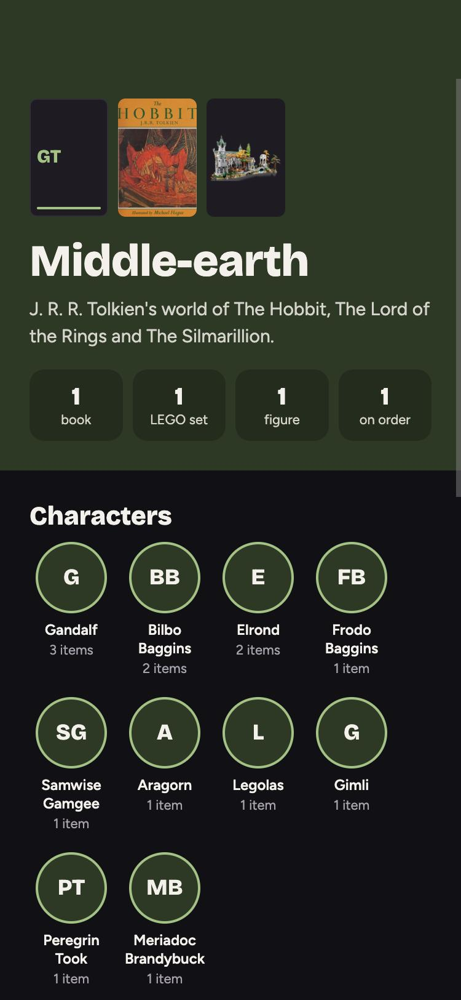</td>
    <td>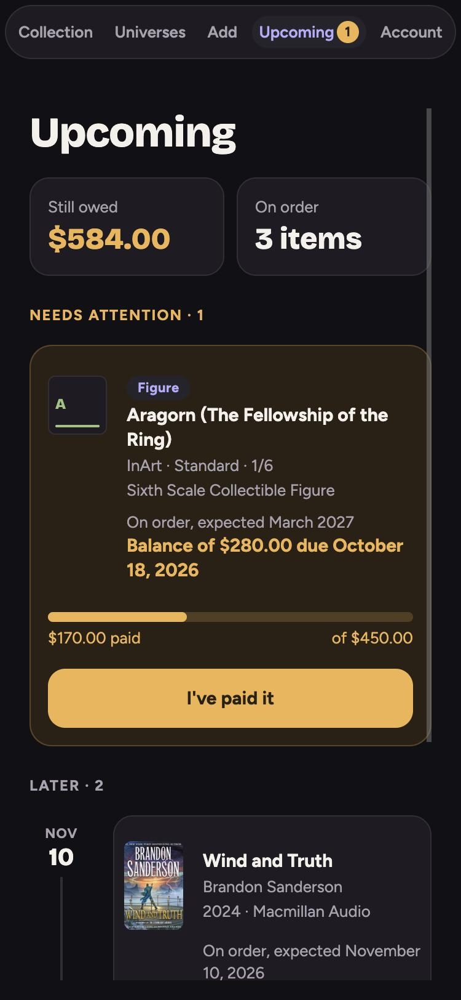</td>
    <td>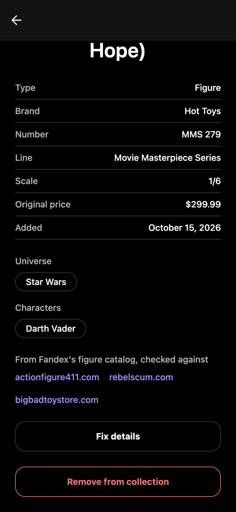</td>
  </tr>
  <tr>
    <td align="center">Your shelf</td>
    <td align="center">A universe</td>
    <td align="center">Upcoming</td>
    <td align="center">A figure, without a photo</td>
  </tr>
  <tr>
    <td>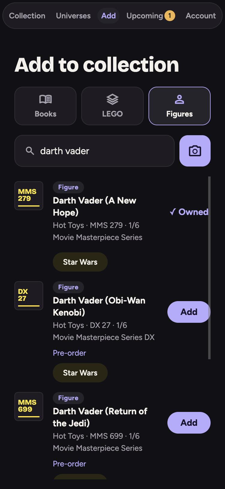</td>
    <td>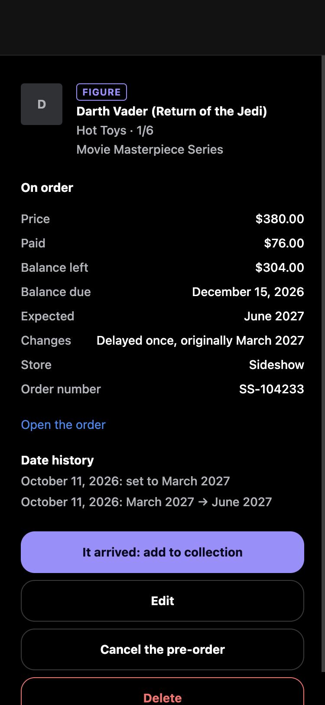</td>
    <td></td>
    <td>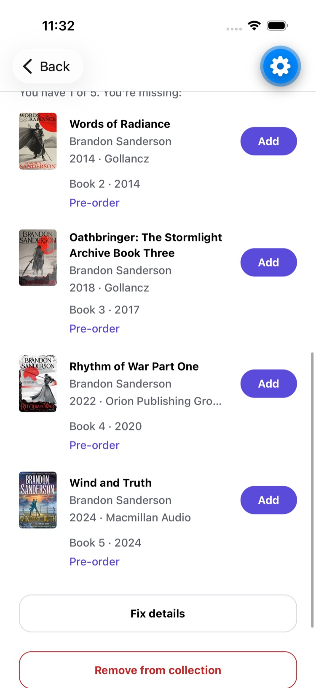</td>
  </tr>
  <tr>
    <td align="center">Adding figures</td>
    <td align="center">A pre-order</td>
    <td align="center">Your series</td>
    <td align="center">What's missing from a series</td>
  </tr>
  <tr>
    <td>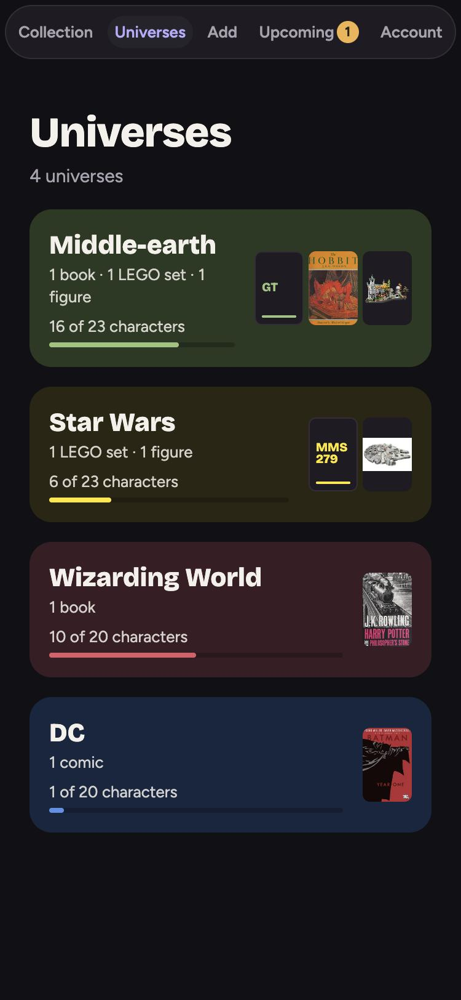</td>
    <td>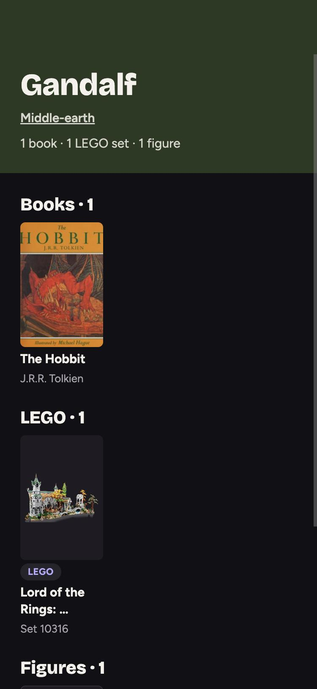</td>
    <td>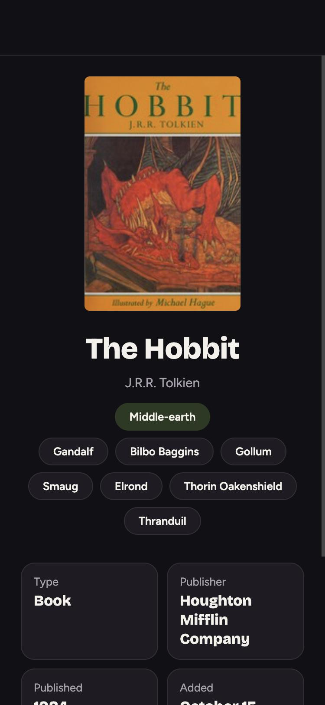</td>
    <td>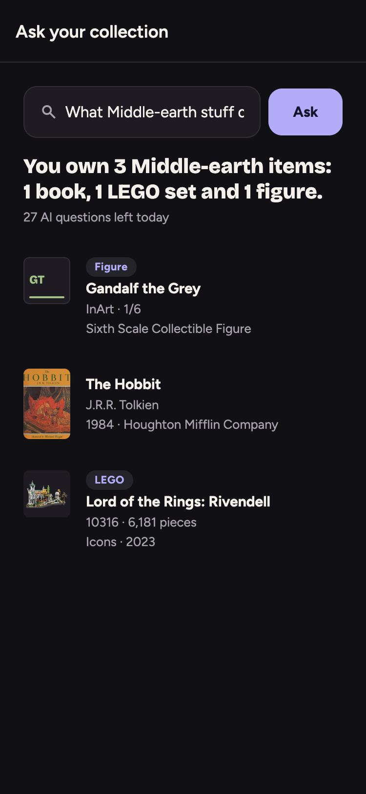</td>
  </tr>
  <tr>
    <td align="center">Universes</td>
    <td align="center">A character</td>
    <td align="center">An item's links</td>
    <td align="center">Ask your collection</td>
  </tr>
  <tr>
    <td>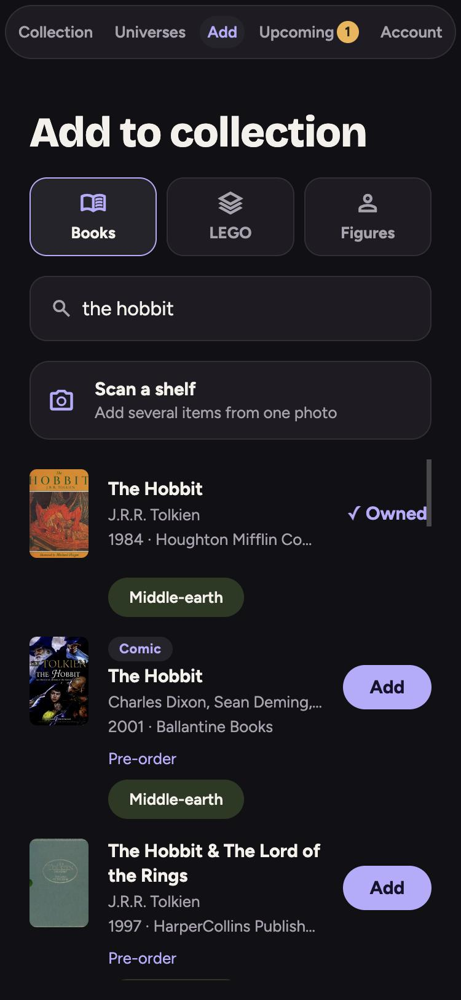</td>
    <td>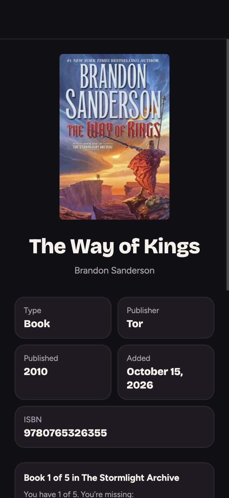</td>
    <td>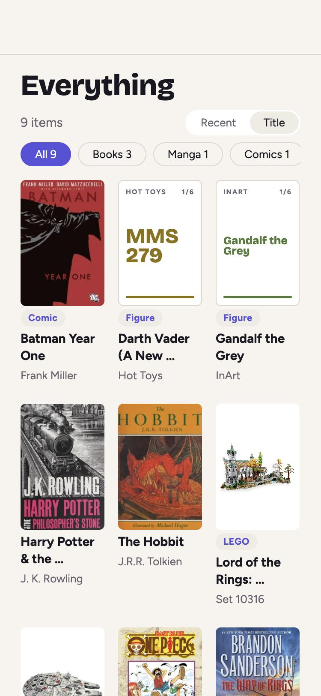</td>
    <td>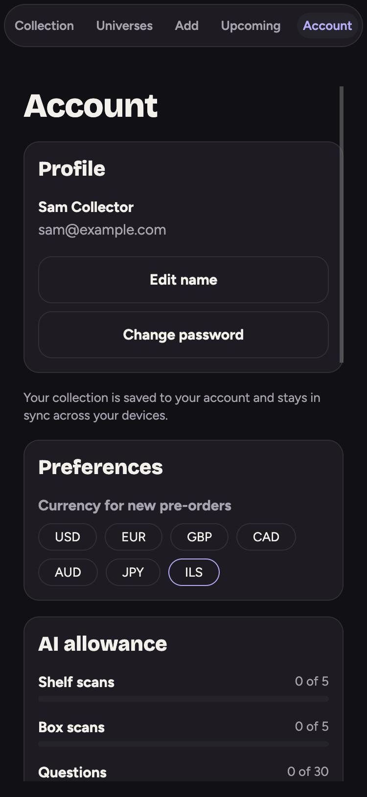</td>
  </tr>
  <tr>
    <td align="center">Search</td>
    <td align="center">Book detail</td>
    <td align="center">Everything, light mode</td>
    <td align="center">Your account</td>
  </tr>
</table>

## Status: Stage 7 (live)

**Live demo: [fandex-4mjc.onrender.com](https://fandex-4mjc.onrender.com)** (free hosting: the first visit after a quiet spell takes about a minute while the server wakes up). API docs: [/api/docs](https://fandex-4mjc.onrender.com/api/docs).

Fandex runs on iPhone and the web from one codebase, backed by its own API:

- **A figure catalog:** search Hot Toys and InArt figures by name, character or the number on the box ("MMS 279", "mms279"), then add or pre-order them; each figure's page shows its number, line, edition, release and original price, and the pages its facts were checked against. Fandex curates the catalog itself — every InArt figure and a starter set of well-known Hot Toys figures for Star Wars, Marvel and DC — because no public catalog or API covers premium figures ([how it's sourced](#the-figure-catalog)). Not there? Add it by hand, with **Suggest it for Fandex's catalog**: an admin approves it (now everyone can find it), merges it into the figure the catalog already has (your item and pre-orders move with it), or says why not.
- **Scan a box (AI):** photograph a figure's box; the AI reads its maker, name and product code and Fandex finds the figure — exactly, when the code is readable. When the catalog doesn't have it, the add-by-hand form opens filled in from the box. Signed-in users, with a daily allowance.
- **Pre-orders:** what's on order, from search or for a figure you describe — price, what you've paid and when the rest is due, the expected release (a day, a month, a quarter or a year, as stores announce them), the store and order link. Every change of the date is kept ("Delayed once, originally March 2027"), and "It arrived" moves it into your collection. For an upcoming book, Fandex fills in the release date Open Library lists and checks it daily, recording a move as a delay. Needs an account.
- **Upcoming tab:** what needs doing first — a balance due within a week or overdue, an expected date that has passed, something arriving this week — then what's arriving this month, later, and with no date yet, with the total still owed. The tab's badge counts what needs attention (the reminder, instead of notifications).
- **"You're missing…":** a book's page says where it sits in its series ("Book 1 of 5 in The Stormlight Archive") and lists the books you don't have, with covers to add or pre-order; a manga or comic volume shows the volumes missing up to the highest you own and the next volume, with its release date when it's upcoming. **Your series** lists every series you have something of, incomplete ones first. Book series come from [Wikidata](https://www.wikidata.org) (by the book's Open Library work, cached for a month); manga and comic volumes from their titles. Works for guests too. The edition offered for a missing book is Open Library's pick, which is occasionally an audiobook or a split volume.
- **Ask your collection:** "What Batman stuff do I own?", "How many Star Wars LEGO sets do I have?", "What's arriving this month?", "How much do I still owe?", "Which manga series am I missing volumes of?" — an answer sentence and the matching items or pre-orders. Signed in, AI turns the question into a search (your collection is never sent to it); guests and offline get keyword matching on the device, labelled as such.
- **Scan a shelf (AI):** photograph one shelf; the AI reads the spines, each reading is matched to the catalog, and you tick what to add on a review screen. Signed-in users, with a daily allowance. On a test bookcase the AI behind it (Gemini) found 94% of the items on one-shelf photos ([evaluation](docs/eval/shelf-recognition.md)).
- **Scan several books:** keep the camera open and scan barcode after barcode; each book appears in a list as it's read (with a haptic tick, owned ones marked), then one tap adds them all. No account needed.
- **Universes and characters:** a Universes tab groups everything you own from eleven universes — Middle-earth, Star Wars, the Wizarding World, DC, Marvel, A Song of Ice and Fire, the Cosmere, One Piece, Pokémon, Jurassic Park and Disney & Pixar — across books, manga, comics, LEGO and figures. Each universe page lists its characters; each character page shows every book they appear in and every set with their minifig. Items are matched automatically from Open Library's characters and places and Rebrickable's themes and minifigs, and you can fix any match (or a misfiled category) by hand.
- **"You own another edition":** search results flag other printings of books you already own.
- **Accounts and cloud sync:** sign up with email and password; your collection follows you between iPhone and web. Without an account it's saved on the device, and signing in offers to move those items into the account.
- **Books, manga, comics, LEGO and figures** in one collection, with category badges and filters. Books come from Open Library (category detected from publisher and subjects), LEGO sets from Rebrickable (search by name or set number, with pieces and theme). Figures come from Fandex's own catalog, or are added by hand — name, brand, box number, edition, line, scale, picture — and linked to their universe and character from the name; those stay private to whoever added them unless suggested for the catalog.
- **Look up by ISBN** or **scan a barcode** with the iPhone camera. Typos are caught by the check digit before any request is made, and only book barcodes are accepted.
- **Your collection:** a cover grid sorted by recently added or by title (ignoring "The"/"A"), a detail screen per item, and removal with confirmation.
- **Your account:** change your name and password (signing out your other devices if you like), choose the currency new pre-orders start in, see today's AI allowance and who reads your photos, download your collection as JSON (everything, pre-orders too) or CSV for a spreadsheet, see the devices you're signed in on and sign any of them out, and delete the account (required by the App Store). The privacy policy and terms are public pages ([/privacy](https://fandex-4mjc.onrender.com/privacy), [/terms](https://fandex-4mjc.onrender.com/terms)), with data credits on the Account tab.
- **Light and dark mode**, screen-reader labels, and browser tab titles on web.

The live demo runs Stage 7. Still open in Stage 7: the owner's spot-check of the curated figure list, and measuring box reading on real box photos (the code and its evaluation script are ready). Next up is Stage 8: launch (see [Roadmap](#roadmap)). What the AI sees and keeps is described under [Privacy and AI](#privacy-and-ai).

## Architecture

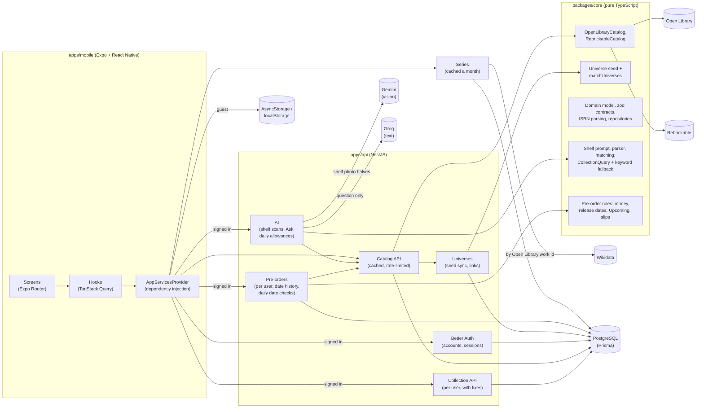

- **`packages/core`** has no React, Node or platform code: the domain model, the zod schemas shared by the API and the app, ISBN validation, the Open Library and Rebrickable adapters, and the collection repository. Both the API and the app use it.
- **`apps/api`** is a NestJS API (in production it also serves the web app from the same origin). It owns the accounts (Better Auth, users stored in our PostgreSQL), caches catalog results in a shared `catalog_item` table, and stores each user's collection. A global guard protects every route unless it's marked public.
- **`apps/mobile`** is the Expo app. Screens get their dependencies (`BookCatalog`, `CollectionRepository`, `AccountService`) from a context provider: signed in, the collection is the API-backed repository; signed out, it's the on-device one. Tests swap in fakes.
- **The universe layer:** a hand-checked seed of universes and characters lives in `packages/core`. A pure function, `matchUniverses`, links each catalog item from the clues its source gives (title, characters, places, LEGO theme, minifigs), with guards against look-alikes (Reagan's "Star Wars" program isn't Star Wars; Norse mythology's Thor isn't Marvel's). The API stores the links per catalog item and re-matches everything on startup when the seed changes; a user's fixes are stored as differences on their own copy, so they survive re-matching. Adding a universe is a data change with three checks (`apps/api/eval/`): every Wikidata id against its label, real Open Library and Rebrickable signals recorded for the tests (look-alikes too), and a report of every link that would change across the local catalog.
- **The AI layer:** two jobs, both behind one provider-neutral client (the OpenAI chat format that Groq, Gemini and Mistral all speak; the provider is a setting). _Shelf scans:_ the app cuts a one-shelf photo into two halves; the model lists what it reads, one line per item; core parses that, and every reading is searched in the catalog and ranked, so what you're offered is always a real catalog entry, and nothing is added until you tick it. _Ask:_ the model turns your question into a `CollectionQuery` (your items or your pre-orders; universes, characters, categories, dates, arriving when, still owed, delayed; list or count) through a strict JSON schema; core runs it on your items or pre-orders and writes the answer, so answers are exact and the model never sees your collection. Without the AI, keyword matching answers. Both are measured against real data: the owner's bookcase for shelf reading, recorded model replies for questions.
- **Pre-orders:** the rules live in core as pure functions with "today" passed in (what needs attention, the Upcoming groups, delays), so the API, the app and Ask agree. Money is integer minor units with a currency, never floats; release dates are a day plus a precision (day, month, quarter, year), compared by the end of their period. Every change of the expected date is a row in a history table, which is where "delayed twice, originally March" comes from.
- **Catalog entries vs. owned copies:** a catalog entry is what a catalog says exists; a `CollectionItem` is the user's copy, with a snapshot of the catalog data so the collection still renders if the source changes or is offline.

### Notable decisions

- **Open Library only.** It's free, keyless and allows browser calls. Google Books was evaluated and rejected: its terms forbid storing results permanently (which a collection does) and charging users without a separate agreement.
- **Cover images by cover ID**, not ISBN: Open Library rate-limits ISBN cover URLs (100 per 5 minutes per IP) but not cover-ID URLs.
- **Ownership is per edition** (matched by ISBN, else by source ID), because collectors care which printing they own.
- **One server, one origin:** the API serves the web app, so the web session cookie is first-party (no third-party cookie problems) and CORS only matters for development.
- **Users only see their own items:** every collection query is scoped by the signed-in user's id (never a request field), and another user's item answers 404 rather than 403. The tests for this were mutation-checked.
- **Universes are computed on the device** from links that travel with each item, so guests get the same universe pages as accounts, offline, updated the moment something is added.
- **Defensive storage:** versioned JSON documents, serialized writes (rapid taps can't overwrite each other), and unreadable data raises an error instead of being silently replaced.

- **A figure catalog of our own facts:** no API or open database covers Hot Toys or InArt, and retailers' and InArt's terms allow personal, non-commercial use only. So nothing is scraped and no text or picture is copied: Fandex writes each figure's facts itself, lists the pages they were checked against, and keeps the list in the repository, where a test checks every entry (known brand, line and characters, box numbers written one way, no figure twice). Users' figures join it only after an admin's review.
- **AI answers are checked, not trusted:** model replies are validated against schemas, readings only count once a catalog entry resembles them (the model invents titles and set numbers), unknown universes and characters are dropped and named in the answer, and questions are capped and counted per user and for everyone, so the free plans can't be used up by one person.

Full decision log: [`CLAUDE.md`](CLAUDE.md).

## Privacy and AI

- **Questions ("Ask your collection")** go to [Groq](https://groq.com): only the question, today's date and the names of the universes Fandex knows. **Your collection and your pre-orders are never sent**; the answer is computed by Fandex from your own data. Groq's terms don't allow it to train on what it receives. It may keep request logs for up to 30 days for abuse checks, unless Zero Data Retention is turned on in the Groq console.
- **Shelf photos** are cut into two halves and resized on your phone, sent once, and **never stored** by Fandex. While Fandex has a single user (its developer), they go to **Gemini's free tier**, which may use them to improve Google's products — the scan screen says so before you pick a photo. If Gemini is busy or doesn't answer, Groq reads the photo instead (the note says that too). Before others use Fandex this moves to paid Gemini (no training on inputs) or back to Groq; it's one setting (`AI_PROVIDER`).
- **Box photos** are handled like shelf photos: resized on your phone, sent once to the same AI (with the same note), never stored.
- **Suggesting a figure** shares it with Fandex's admin, with your name and email, so they can review it. An approved figure joins the shared catalog **without its picture link** (product photos usually belong to a brand or a shop).
- **Only signed-in users** can use the AI, and **keys stay on the server**. Guests, and anyone offline, get keyword answers computed on their device, with nothing sent anywhere.
- **What's stored:** how many AI requests you made each day (for the allowance), nothing about their content. It's deleted with your account.
- Rebrickable's LEGO data never reaches a model (its terms forbid using it to train AI).
- **Taking your data with you:** the Account tab downloads your collection as a JSON or CSV file, built on your device. The list of signed-in devices shows device types only: Fandex's API never sends session tokens or IP addresses to the app.
- The full [privacy policy](https://fandex-4mjc.onrender.com/privacy) says what's stored and who processes it.
- **Book series:** Fandex's server asks Wikidata about a book's Open Library work id — never who owns it — and keeps the answer for everyone for a month.

## Repository layout

```
apps/
  api/               NestJS API: accounts (Better Auth), cached catalog (books, manga, comics, LEGO), per-user collections, PostgreSQL via Prisma, OpenAPI docs
    prisma/          Database schema and migrations
    src/             Modules: auth, catalog, collection, universes, ai, health, me
    test/            End-to-end tests against a real test database
    eval/            AI evaluation: shelf photos (not committed) vs what's really on the shelf; recording real "Ask" replies
  mobile/            Expo app (Expo Router): iOS, Android and web
    src/app/         Routes: (tabs)/index, (tabs)/universes, (tabs)/add, (tabs)/account, universe/[slug], universe/[slug]/[character], book/[id], edit/[id], scan, shelf-scan, ask
    src/components/  UI components
    src/hooks/       Data hooks (search, collection, account)
    src/services/    App services and their wiring (API clients, repositories)
packages/
  core/              Domain model, zod contracts, ISBN utilities, catalog adapters, repository, universe seed and matching, AI prompts and parsers, the "Ask" query engine
docs/plans/          Stage plans and task lists
docs/eval/           AI evaluation results
docs/screenshots/    README images
render.yaml          Deployment (Render Blueprint)
```

## Getting started

Requirements: Node 24+ (see `.nvmrc`), npm, and [Docker Desktop](https://www.docker.com/products/docker-desktop/) for the local PostgreSQL database. For the iPhone, install [Expo Go](https://apps.apple.com/app/expo-go/id982107779).

```bash
npm install
cp apps/api/.env.example apps/api/.env     # then set BETTER_AUTH_SECRET (openssl rand -base64 32)
npm run db:up                              # start PostgreSQL in Docker
npm run db:deploy -w @fandex/api           # apply database migrations
npm run dev:api                            # API on http://localhost:3000, docs at /api/docs
```

In a second terminal:

```bash
npm run start -w @fandex/mobile
```

- **iPhone:** scan the QR code with the Camera app (phone and computer on the same Wi-Fi). The app finds the API on your computer automatically.
- **Web:** press `w` in the terminal.

To point the app at the deployed API instead of a local one:

```bash
EXPO_PUBLIC_API_URL=https://fandex-4mjc.onrender.com npm run start -w @fandex/mobile
```

### Publishing the iPhone app (no Mac needed to run it)

The iPhone app is published with [EAS Update](https://docs.expo.dev/eas-update/introduction/): Expo hosts the JavaScript bundle (with the deployed API URL built in), and Expo Go opens it without a dev server.

```bash
npm run update:ios -w @fandex/mobile    # publish the current code to the main branch
```

On the iPhone, sign in to Expo Go with the account that owns the project, then open **fandex → main** under Projects. Expo Go fetches new updates when the app is reopened. Expo's free plan covers this and can't incur charges.

To review figure suggestions, list your account's email in `ADMIN_EMAILS` in `apps/api/.env`; the Account tab then shows **Review figure suggestions**.

LEGO search needs a free [Rebrickable API key](https://rebrickable.com/users/settings/#api) in `apps/api/.env` (`REBRICKABLE_API_KEY=...`); everything else works without it.

## Deployment

The API and the web app deploy together as one free [Render](https://render.com) web service, defined in [`render.yaml`](render.yaml), with a free [Neon](https://neon.com) PostgreSQL database. The API serves the exported web app from its own origin, so the browser's session cookie is first-party. Migrations run on every start, and every push to `main` redeploys. Secrets (database URL, Rebrickable key) live only in the Render dashboard; Render generates the session secret. On the free plan the service sleeps after 15 minutes without traffic and takes about a minute to wake.

## Testing

```bash
npm test            # all workspaces
npm run typecheck
npm run lint
npm run format:check
```

1,148 tests run in CI on every push:

- **`packages/core` (568, Jest + ts-jest):** device names from real User-Agents ("Fandex on iPhone", "Chrome on Mac"), the curated figure list itself (every entry's brand, line, characters, box number and sources checked; no figure listed twice), figure box numbers in every common spelling ("MMS649", "TMS007", die-cast "MMS 528 D30"), spotting duplicate figures, figure search over the real list (by name, character, box number, ignoring accents and scale), reading figure boxes (replies in labelled lines, with markdown and chatter around them) and matching them to the catalog (the box number first — mutation-checked), ISBN validation against reference values, volumes read from real manga and comic titles ("One Piece, Vol. 24", "ONE PIECE 113", not "Spider-Man 2099" or box sets), book series parsed from recorded real Wikidata answers (main line apart from novellas, the series a book is numbered in), the next volume picked out of recorded real searches, questions about series (rules mutation-checked), reading Open Library's free-text publish dates ("Nov 10th 2026", "28.06.2027", "2027") as release dates, questions about pre-orders (what arrives when, what's still owed per currency, what was delayed — rules mutation-checked), parsing real (sometimes looping) AI replies about shelf photos, comparing two real readings of one shelf to separate real titles from invented ones, pre-order rules with a pinned "today" (money in exact minor units, release dates by day, month or quarter, what needs attention, delays — mutation-checked), answering questions about a sample collection (the roadmap's questions through recorded real model replies and the keyword fallback, users' own fixes respected — mutation-checked), matching what the AI read to recorded real Open Library and Rebrickable results (misreadings, invented set numbers, Marvel's Civil War among history books — rules mutation-checked), universe and character matching against recorded real data for all eleven universes (including look-alikes such as a book about the "Star Wars" missile defense program, Norse mythology's Thor, Conan Doyle's The Lost World, a picture book called All in One Piece and the Pirates of the Caribbean sets under LEGO's Disney theme), book/manga/comic classification against real Open Library subject data, the Open Library and Rebrickable adapters against **recorded real API responses** plus edge cases, and the repository (concurrent writes, corrupt data, restarts) over an in-memory store.
- **`apps/api` (246, Vitest + Supertest):** the account page (renaming with names checked on the server, changing the password and signing out other devices, the preferred currency, listing and signing out devices without tokens or addresses, isolated per user — mutation-checked), the shared figure catalog (the curated list synced on start with stable ids, curated links that survive re-matching, search by name or box number, other users' private figures never returned — mutation-checked), figure suggestions (your own figures only, admins only, approving shares a figure without its picture, merging moves the suggester's items and pre-orders, approved figures kept when the list changes — four rules mutation-checked), box scanning with a fake model (the box number finding the exact figure, its own daily allowance — mutation-checked — and failures not counted), config validation, caching and rate limiting, the AI client (rate limits, errors, timeouts), the AI provider setting (Groq or Gemini: endpoint, key, readings per scan, Groq taking over a scan when Gemini fails), questions about your collection (answered only from your own items, the collection never sent to the model, keyword fallback when the AI is unavailable or over the allowance and not counted — mutation-checked), shelf-photo scanning with a fake model (each photo read twice on Groq, what only one reading found marked less sure, uploads, catalog candidates marked when owned, daily allowances per user and for everyone, isolation between users, provider failures not counted — mutation-checked), simultaneous searches saving the same books (a deadlock found by a real scan), plus end-to-end tests against the real Nest app and a real PostgreSQL test database (created and migrated automatically), including sign-up/sign-in, native-app sessions, CORS, account deletion, password hashing, CSRF protection, the catalog API (validation, database caching, upstream failures) with a fake Open Library, the collection API, including isolation between users (mutation-checked), storing and backfilling universe-matching signals (resumable after failures, without erasing LEGO minifigs), and the universe API (seed sync that keeps ids and drops stale universes, links on every catalog response, your collection by universe with user isolation mutation-checked), per-item fixes (category and links, validated, isolated per user, surviving re-matching), pre-orders (scoped per user, every change of the expected date kept, paid never above the price, "arrived" moving the item into the collection once — mutation-checked), book release dates followed daily from Open Library (only while the pre-order follows its date, never to a vaguer date, a move recorded once even when listed at the same moment — mutation-checked), questions about pre-orders (answered only from your own — mutation-checked), book series cached from a fake Wikidata (asked once for a whole series, again after a month, a stale copy when it fails, stopping when rate-limited, "not known yet" vs "no series" — mutation-checked) and questions about series (your own books only — mutation-checked), and figures added by hand (private to their owner — mutation-checked — linked to universes from the name, deleted with the copy or the account).
- **`apps/mobile` (360, jest-expo + React Native Testing Library):** the Account tab (profile, currency, AI allowance, export files — CSV quoting and formula cells — signed-in devices, About and the legal pages, a 401 re-checking who is signed in), the figure catalog on the Add tab (search, add, a figure's facts and sources, "Add it by hand" starting from what was typed), suggesting a figure and seeing the outcome, the admin review screen (approve, merge and reject, admins only — mutation-checked), box scanning (found by number, the add-by-hand form filled in from the box — mutation-checked), screens rendered with a fake catalog, a fake account service and the real repository over an in-memory store: search states, ISBN lookup, adding and removing, navigation, sorting, accounts (sign-in, sign-up, sign-out, delete account), cloud sync (account vs device collection, moving device books into an account), LEGO search and detail, category filters, the Universes tab, universe and character pages (guest and account), universe links on items and search results, fixing an item's category, universes and characters (guest and account), "you own another edition" hints, the barcode scanner with a mocked camera (one book, or book after book with repeat reads ignored and failed lookups retried), asking about your collection (AI answers from a fake server, keyword answers on the device for guests and offline, waiting for the account before answering), pre-orders (form with exact amounts and a date picker for days, months and quarters, full edits that clear emptied fields, arriving into the collection, a figure saved only with its pre-order, the Upcoming tab's groups, owed total and badge count, Open Library's date offered for an upcoming book, "couldn't load" with a retry instead of "not found", the server's reason when an action is refused), questions about pre-orders (guests told they need an account), "you're missing…" on item pages (books and volumes, adding a missing book, asking again when Wikidata was slow — mutation-checked) and the Series view (order, failures and retry), questions about series (on the device and from the server), adding a figure by hand (on the device for guests, on the server when signed in, moved into an account on sign-in), and shelf scanning with a mocked photo picker (cutting the photo into halves, uploading them as files, review with less sure items unticked, fixes, adding what's ticked, allowance and busy errors).

Tests never call the network.

**On the iPhone:** seven [Maestro](https://maestro.mobile.dev) flows drive the real app in Expo Go on the iOS Simulator — a guest adding and removing a book, asking about the collection, a book's series and the Series view with live Wikidata and Open Library data, finding a Hot Toys figure by its box number and adding it, an account pre-ordering an upcoming book through to "It arrived" and deleting itself, and an account renaming itself, picking a currency and finding its devices and privacy policy ([apps/mobile/e2e](apps/mobile/e2e/README.md)). They run locally (not in CI) and found what the other tests can't see: a "0" badge on the native tab bar and number pads with no way to put them away.

AI quality is measured separately, because a model's answers aren't pass/fail: `npm run eval:shelf -w @fandex/api` sends the owner's shelf photos to the model and scores what it read against a hand-written list of what's really there. It calls the real API, so it doesn't run in CI. On 9 one-shelf photos (52 items, the way the app sends them):

| Model                                 | Items found | Readings that were real |
| ------------------------------------- | ----------- | ----------------------- |
| Groq `qwen/qwen3.8-27b` (free)        | 42%         | 41%                     |
| Groq, two readings, agreed items only | 31%         | 69%                     |
| Gemini `gemini-3.5-flash`             | **94%**     | **94%**                 |
| Mistral `ministral-14b` (free)        | 36%         | 50%                     |

Details, including Hebrew spines and built LEGO models: [docs/eval/shelf-recognition.md](docs/eval/shelf-recognition.md). Figure boxes get the same treatment: `npm run eval:boxes -w @fandex/api` reads the owner's box photos and scores brand, box number, name and whether the right catalog figure came first (results to come, once there are box photos). For "Ask", `npx tsx eval/record-ask.ts` records the model's real replies to 18 questions (5 about pre-orders, and an attempt to give it orders), which core's tests then run.

## Concepts for .NET developers

This project was built by a C#/.NET developer learning React Native. If that's you too:

| Here                                     | Roughly like in .NET                                 |
| ---------------------------------------- | ---------------------------------------------------- |
| npm workspaces (`apps/*`, `packages/*`)  | A solution with several projects                     |
| `packages/core` consumed as source       | A class-library project reference                    |
| Expo Router (`src/app/` files = routes)  | Razor Pages file-based routing                       |
| `_layout.tsx`                            | `_Layout.cshtml`                                     |
| `AppServicesProvider` + `useCatalog()`   | Registering and resolving services in a DI container |
| TanStack Query                           | A cached `HttpClient` plus state management          |
| `foo.web.ts` next to `foo.ts`            | Conditional compilation per platform                 |
| Metro                                    | The bundler (like webpack)                           |
| EAS Build                                | A cloud CI service for native app binaries           |
| Expo Go                                  | A prebuilt host app that runs your JavaScript bundle |
| NestJS modules, controllers, providers   | ASP.NET Core controllers and DI registrations        |
| Global `AuthGuard` + `@AllowAnonymous()` | A fallback authorization policy + `[AllowAnonymous]` |
| Prisma schema + migrations               | EF Core model + migrations                           |
| zod schemas in `packages/core`           | Shared DTOs with validation attributes               |
| Vitest + Supertest e2e tests             | `WebApplicationFactory` integration tests            |
| `onModuleInit` seed sync                 | Seeding data in an `IHostedService` at startup       |
| Prisma `Json` columns                    | EF Core owned types stored as JSON                   |

## The figure catalog

Premium figures have no public catalog: Hot Toys and InArt publish no database or API, Wikidata has none of their figures, and the checklists that exist belong to retailers whose terms allow personal use only. Fandex's catalog (`packages/core/src/figures/seed/`, researched October 2026) is therefore its own:

- **Facts, not copies:** name, brand, line, box number, edition, scale, characters, announcement and release dates, and original price — written fresh, never copied text or pictures. Every entry lists the pages it was checked against; the app shows them as links.
- **InArt (83 figures, every one on its official shop):** names, editions and prices from [InArt's shop](https://global.inart.studio) (the price of the first pre-order's full payment), dates from its pre-order windows and shipping estimates, cross-checked with news posts (Toy-People, DC Collectors). InArt's box codes aren't documented reliably, so its figures have no number yet.
- **Hot Toys (80 figures for Star Wars, Marvel and DC):** box numbers and US prices from [Action Figure 411](https://www.actionfigure411.com)'s checklists, **each confirmed by a second page** (a retailer listing that shows the number, Sideshow, or the announcement). Hot Toys has never made Middle-earth or Wizarding World figures; InArt covers both.
- **Where sources disagree** (prices, an unstated year), the entry says so in a note instead of guessing. The owner spot-checks a sample before the list ships, and it grows through users' suggestions and later batches.
- **No catalog pictures yet:** photos belong to the brands and shops, and the free hosting has no storage for uploads. A licensed product feed (Sideshow's affiliate program) is a possible later source.

## Data sources and attribution

Book data and cover images come from [Open Library](https://openlibrary.org), a project of the Internet Archive. LEGO set data and images come from [Rebrickable](https://rebrickable.com). The universe and character list was drafted from [Wikidata](https://www.wikidata.org) (CC0), and book series come from Wikidata's query service (CC0; asked with a descriptive User-Agent, spaced, and cached for a month). The native app identifies itself to the Open Library API (browsers can't set the header), Fandex caches responses, and only makes requests on behalf of a person, per their [API guidelines](https://openlibrary.org/developers/api).

## Roadmap

| Stage                     | Demo at the end                                                                    |
| ------------------------- | ---------------------------------------------------------------------------------- |
| **1. MVP** ✅             | Add books by search, ISBN or barcode; collection with covers on iPhone and web     |
| **2. Real backend** ✅    | Accounts, cloud sync phone ↔ web, manga/comics/LEGO catalogs                       |
| **3. Universe layer** ✅  | Franchise and character pages linking items across categories                      |
| **4. AI** ✅              | Shelf photo → identified items, rapid barcode scan, questions about the collection |
| **5. Pre-orders** ✅      | Pre-orders (custom figures too), payments due, release dates and slips, Upcoming   |
| **6. You're missing…** ✅ | Book series and manga/comic volumes: what's missing and what's next                |
| **7. Figure catalog** ✅  | Curated Hot Toys and InArt figures, approved user suggestions, AI that reads a box |
| 8. Launch                 | TestFlight → App Store, shareable public collection pages                          |

## License

All rights reserved. The source is public for review; no license to reuse it is granted.
